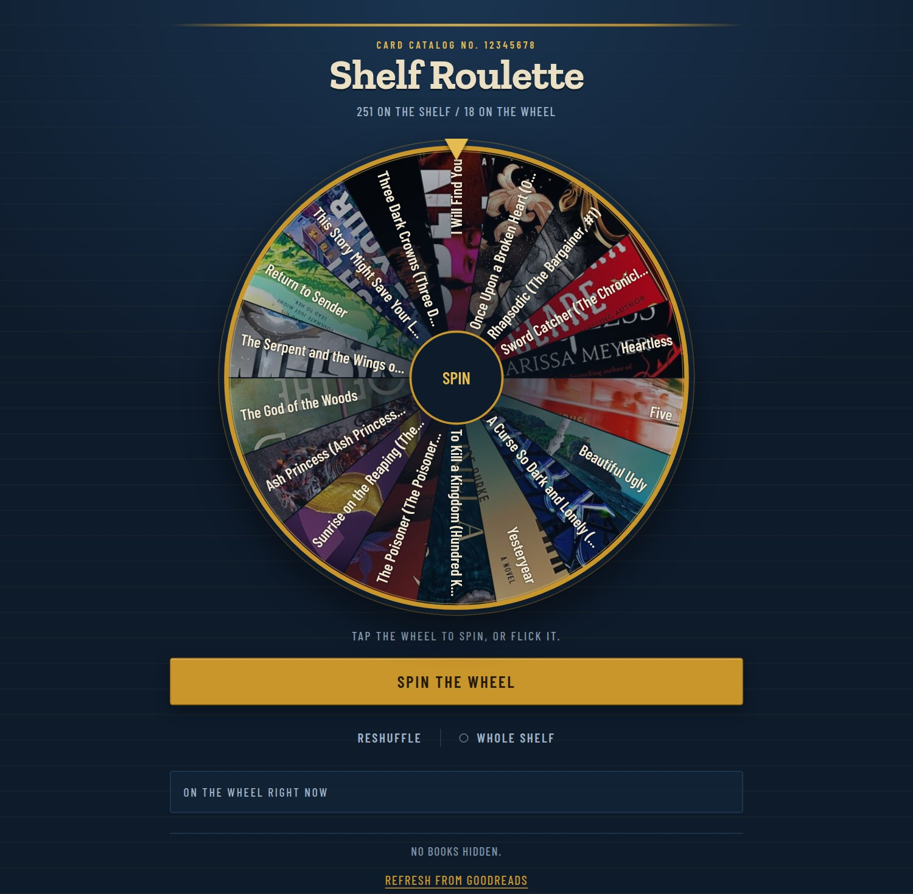
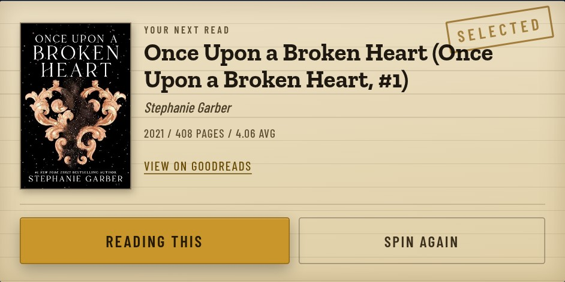

# Shelf Roulette

**What it is:** a self-hosted wheel of book spines that reads your Goodreads to-read shelf live and spins to pick what you read next. Two small containers, everything stays on your LAN, no CSV export and no writes back to Goodreads.





(The slip screenshot predates October 2026 and also shows year, page count and average
rating. Goodreads stopped publishing those along with its RSS feeds, so the slip now shows
cover, title, author and the link.)

**Requirements:** Docker with the Compose plugin. Nothing else — no Node, no Python, no build step.

**The one env var to set:** `GOODREADS_USER_ID` in `.env`. There is no default; the app tells you so in the browser until you set it.

**The one command to run:**

```bash
cp .env.example .env          # then put your GOODREADS_USER_ID in it
docker compose pull && docker compose up -d
```

That pulls the published images and starts in seconds. To build from source
instead — which is what you want if you are changing the code — use
`docker compose up -d --build` and skip the pull.

Then open **http://localhost:8088** (or `http://<host>:8088` from another machine on the LAN).

---

## Reaching it over Tailscale

The LAN URL only works on the LAN. To spin the wheel from a phone on cellular, publish it to
your tailnet with Tailscale Serve:

```bash
sudo tailscale serve --bg --https=8443 http://127.0.0.1:8088
```

That gives **https://&lt;machine&gt;.&lt;tailnet&gt;.ts.net:8443** — tailnet only, never Funnel, so it is
not exposed to the public internet. Serve terminates TLS with a real Let's Encrypt certificate,
which matters for more than the padlock: iOS only offers **Add to Home Screen** on a secure
origin, so the PWA install described below works over this URL and not over the plain-HTTP LAN
one.

Pick a port nothing else on the host has claimed, and check both sides before you do:

```bash
tailscale serve status      # what the tailnet already publishes
ss -ltn                     # what is bound locally
```

The serve config is stored in `tailscaled`'s state, so it survives a reboot. To undo it, pass
the same port back with `off`:

```bash
sudo tailscale serve --https=8443 off
```

Two things to check on the phone if the URL does not load, because neither produces a useful
error message:

- Tailscale has to be **connected** on that device — a disconnected client cannot resolve the
  name at all.
- **Use Tailscale DNS** has to be on. MagicDNS names resolve only through `100.100.100.100`;
  public resolvers return nothing for them.

And include the port. Dropping it sends the browser to 443, which Serve is not listening on
unless you put it there.

### Why the app is built to survive that path

A tunnelled phone is not a reliable client, and the failure is silent rather than loud: the
tunnel re-handshakes whenever the phone changes network, iOS suspends a backgrounded tab and
kills its in-flight requests, and a sleeping radio can take a full second just to answer. A
request lost that way never fails — it simply never returns.

So the frontend never waits forever. Every shelf request gets a 12 second deadline (30 for a
forced refresh, which makes the proxy walk Goodreads live), a failed attempt is retried three
times on a short backoff with the attempt count shown in the loading panel, and the app
refetches on its own when the device comes back online or the tab returns to the foreground. A dropped connection now heals without the user knowing; only a genuine,
repeated failure reaches the error panel.

The one thing that is never retried is an error the backend deliberately sent, such as
"shelf is empty or private". That is a considered answer, not a dropped packet, so it is shown
as-is rather than hammered.

On the backend, `roulette-proxy` refreshes the shelf on a timer just before the cache expires,
so the cached copy is replaced instead of going cold. A cold fetch is a walk over several
Goodreads widget requests, and every client timeout this app ever recorded landed on a request
that arrived to an empty cache and had to sit through it. Now `/api/shelf` answers from memory
in single-digit milliseconds even on the first open of the day. The walk itself is capped at 45
seconds, deliberately under nginx's 60 second `proxy_read_timeout`, so a slow upstream produces
this app's own JSON error rather than an nginx HTML gateway page.

When Goodreads cannot be reached at all, the proxy serves the last shelf it parsed and the
masthead says so, with its age. That copy is also written to the cover-cache volume, so a
restart in the middle of an outage still comes back with a shelf to spin rather than an error.
A failed fetch is not retried upstream for a minute, so a phone's retries do not multiply it.

---

## Why there is a proxy

Goodreads retired its API in December 2020 and its per-shelf RSS feeds in October 2026, and
the shelf pages themselves now redirect to sign-in. What still answers without a session is
the pair of embeddable shelf widgets Goodreads offers under "Share your books":

```
https://www.goodreads.com/review/grid_widget/<user-id>.shelf?shelf=to-read&num_books=200&sort=date_added&order=d&widget_id=...
https://www.goodreads.com/review/custom_widget/<user-id>.shelf?shelf=to-read&num_books=100&show_author=1&...
```

Each is a JavaScript snippet carrying the shelf as HTML, CORS-blocked, and capped (200 books
for the grid, 100 for the custom one, with `page` ignored). `roulette-proxy` fetches them
server-side, walks the shelf in several sort orders until the union stops growing, fills in
authors from the custom widget, checks the count against the public profile page, and
re-serves clean JSON. It also streams cover images through so the browser never talks to
Goodreads at all.

The widgets carry the title, author, cover and review link, and nothing else: page count,
publication year and average rating are gone with the feed, so those fields are `null`.

## Architecture

```
browser  ->  roulette-web (nginx :8080, published on host :8088)
                 |  static HTML/CSS/JS, vendored fonts, icons
                 |  /api/*  reverse proxied over the internal network
                 v
             roulette-proxy (FastAPI :8000)
                 |  shelf widget walk, in-memory TTL cache, saved copy on disk
                 |  cover streaming with on-disk cache
                 v
             goodreads.com
```

The browser only ever talks to one origin, so there is no CORS problem and no mixed-origin image loading. Only `roulette-proxy` reaches the internet, and only to `goodreads.com` and `gr-assets.com`.

**Backend stack choice:** Python with FastAPI plus httpx. One line of justification: httpx gives async sequential fetching and image streaming from a single client, while `html.parser` in the standard library parses the widgets with no extra parser dependency.

## Where the Goodreads user id comes from

Open your Goodreads profile. The URL looks like:

```
https://www.goodreads.com/user/show/12345678-yourname
```

The digits before the dash are your user id. Put that in `.env` as `GOODREADS_USER_ID`.

The profile and shelf must be publicly visible for the widgets to return anything. If they are
not, or the id is wrong, `/api/shelf` answers with a 502 explaining exactly that. The only fix
is to make the profile public in your Goodreads privacy settings: the private-feed key that
used to unlock an RSS feed went away with the feeds.

## Configuration

All config lives in `.env`. See `.env.example` for the annotated version.

| Variable | Default | What it does |
| --- | --- | --- |
| `GOODREADS_USER_ID` | none, **required** | Numeric Goodreads user id to read |
| `GOODREADS_SHELF` | `to-read` | Shelf name to spin |
| `SHELF_TTL_SECONDS` | `3600` | How long the parsed shelf is cached in memory |
| `HOST_PORT` | `8088` | Host port the UI is published on |
| `LOG_LEVEL` | `info` | Proxy log verbosity |

## Verify the proxy before touching the UI

The proxy is not published on the host (only the web container can reach it), so run curl inside the compose network:

```bash
# Full shelf as JSON, through the web container's reverse proxy
curl -s http://localhost:8088/api/shelf | head -c 400

# Same thing, pretty, with a count
curl -s http://localhost:8088/api/shelf | python3 -c 'import json,sys; d=json.load(sys.stdin); print(len(d), "books"); print(json.dumps(d[0], indent=2))'

# Health
curl -s http://localhost:8088/api/health

# Bypass the cache and refetch from Goodreads
curl -s "http://localhost:8088/api/shelf?refresh=1" | python3 -c 'import json,sys; print(len(json.load(sys.stdin)), "books")'

# Hit the proxy container directly if you prefer
docker compose exec proxy python -c "import urllib.request,json; print(len(json.load(urllib.request.urlopen('http://127.0.0.1:8000/api/shelf'))), 'books')"
```

A healthy response is a JSON array of objects shaped like this:

```json
{
  "title": "We Used to Live Here",
  "author": "Marcus Kliewer",
  "pages": null,
  "rating": null,
  "year": null,
  "coverUrl": "https://i.gr-assets.com/images/S/compressed.photo.goodreads.com/books/1697756012l/199798006._SX98_.jpg",
  "goodreadsUrl": "https://www.goodreads.com/review/show/8813642662"
}
```

`pages`, `rating` and `year` are always `null` now; the keys stay so older clients keep
working. `author` can be an empty string on a very large shelf, because the author-bearing
widget is capped lower than the one that lists the books.

## API

| Endpoint | Behaviour |
| --- | --- |
| `GET /api/shelf` | Full shelf as a JSON array. Cached for `SHELF_TTL_SECONDS`. Add `?refresh=1` to bypass the cache. |
| `GET /api/cover?url=...` | Streams a cover image through with the right content type. Restricted to `goodreads.com` and `gr-assets.com` hosts, so it is not an open proxy. Cached on disk in a named volume. |
| `GET /api/health` | Returns 200 without touching the network. |

If Goodreads is slow or down, `/api/shelf` returns the last good copy with `X-Shelf-Stale: 1` and `X-Shelf-Age: <seconds>` headers, and the UI shows a note with that age under the masthead. The copy survives restarts (it is saved as `last-good.json` in the cover-cache volume). If there is no copy at all, it returns a 502 with a JSON error body that the UI displays directly, and does not ask Goodreads again for a minute unless `?refresh=1` is passed.

## Using it

- Tap the wheel to spin, or flick it and let the throw carry the spin.
- **Reshuffle** redraws the wheel in a new random order.
- **Whole shelf** is a toggle in the quiet line under the spin button. Lamp lit means every book is on the wheel, lamp dark gives the readable set. The choice is remembered.
- **Reading this** hides that book locally in `localStorage` so it stops coming up. Nothing is written back to Goodreads. **Clear hidden list** in the footer brings them all back.
- **Refresh from Goodreads** forces a cache bypass if you just added books.

### The two wheel modes

**Whole shelf** is the default: every book on the shelf gets its own spine, however many that is. On a shelf of a couple of hundred books each wedge is a degree or two wide, so spine titles and jacket art are physically impossible and are dropped rather than rendered as mush. The wheel becomes a packed shelf of coloured spines, and the winning pick is marked with a brass tab at the rim plus the full result slip underneath. Every book has an equal chance, which is the point.

**Readable set** falls back to a slice sized for the viewport: 18 spines on desktop, 10 below 500px, because eighteen titles on a phone is unreadable. This is the only mode where titles fit on the spines, and on viewports 500px and wider it also paints each book's cover into its wedge. The full shelf stays the pool either way, and the winning slip always shows the cover in both modes.

Rendering adapts automatically rather than by mode name: labels appear whenever a wedge is wide enough for 11px type, separator hairlines appear whenever a gap would read as a gap, and cover art appears at 24 spines or fewer. So a shelf that shrinks to 20 books will start showing titles again on its own.

Accessibility and mobile behaviour: `prefers-reduced-motion` snaps straight to the result with no spin, every control is at least 44px tall, focus rings are visible, the canvas is sized by `devicePixelRatio` so it stays sharp on retina screens, layout uses `dvh` and `env(safe-area-inset-*)`, and in readable-set mode the candidate list is also available as plain text under "On the wheel right now" for screen readers and keyboard users. In whole-shelf mode that disclosure is hidden entirely, since hundreds of rows help nobody and rebuilding them on each reshuffle is pure waste. The winning pick is always announced through an `aria-live` region either way.

## Install to a home screen

A web app manifest plus icons ship with the web container, so Brave and Chrome offer "Install app" or "Add to Home screen". It installs standalone with an ink-navy theme colour.

## Fonts

Zilla Slab and Barlow Condensed are vendored as woff2 files in `web/site/fonts/` and served with `@font-face` from the same origin. Nothing is fetched from `fonts.googleapis.com`, so typography does not depend on outbound internet access. Both are redistributed under the SIL Open Font License 1.1; the licence and its copyright notices are in [`web/site/fonts/OFL.txt`](web/site/fonts/OFL.txt).

## Operating it

```bash
docker compose up -d --build     # start or rebuild
docker compose ps                # health status of both containers
docker compose logs -f proxy     # follow the proxy
docker compose restart proxy     # clear the in-memory shelf cache (the saved copy on disk is kept)
docker compose down              # stop, keeps the cover cache volume
docker compose down -v           # stop and drop the cover cache too
```

Both services declare `restart: unless-stopped` and a healthcheck, so they come back after a reboot of the host.

## Layout

```
.
├── docker-compose.yml
├── .env.example
├── LICENSE
├── README.md
├── docs/                  README screenshots
├── proxy/                 roulette-proxy, FastAPI + httpx
│   ├── Dockerfile
│   ├── requirements.txt
│   ├── app/
│   └── tests/             offline parser tests: python3 -m unittest discover -s tests -t .
└── web/                   roulette-web, nginx serving static files
    ├── Dockerfile
    ├── nginx.conf
    └── site/
        ├── index.html
        ├── styles.css
        ├── app.js
        ├── manifest.webmanifest
        ├── fonts/
        └── icons/
```

## Images

Released images are published to GHCR for `linux/amd64` and `linux/arm64`, so a
Raspberry Pi or an ARM VM runs them without compiling anything:

```
ghcr.io/nullroute727/shelf-roulette-proxy:latest
ghcr.io/nullroute727/shelf-roulette-web:latest
```

`SHELF_ROULETTE_TAG` in `.env` picks the tag. It defaults to `latest`; set it to
a version such as `1.0.0` to pin. Tagging `vX.Y.Z` builds and publishes both.

## Licence

[MIT](LICENSE) for the source. The vendored fonts keep their own licence — see
[`web/site/fonts/OFL.txt`](web/site/fonts/OFL.txt).

## A note on Goodreads

This is an unofficial personal project with no affiliation with, endorsement by, or connection
to Goodreads or Amazon. It reads the public shelf widgets that Goodreads offers for embedding,
a handful of requests per refresh with a delay between them, and caches the result for an hour
by default. It never writes anything back and holds no credentials at all. Book metadata and
cover art belong to Goodreads and the respective rights holders.
